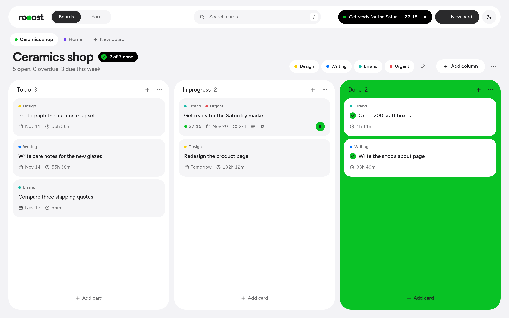
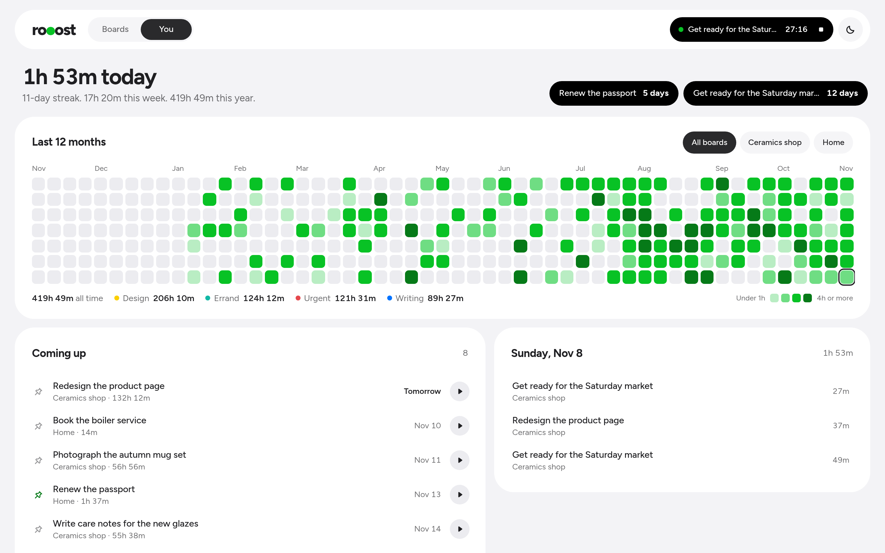

<div align="center">

<picture>
  <source media="(prefers-color-scheme: dark)" srcset="docs/logo-dark.png">
  
</picture>

### Plan it. Time it. Watch your year fill in.

A calm Kanban board with a timer on every card.

**[Open rooost](https://rooost.vercel.app/)**

<br>

<picture>
  <source media="(prefers-color-scheme: dark)" srcset="docs/boards-dark.png">
  
</picture>

</div>

<br>

## Boards

Where you plan. Drag cards toward the finish line, and the last column turns into it.

- **A timer on every card.** Press play and it keeps running while you use the rest of the app.
- **Tags you name yourself,** in the colours you like.
- **One board or several,** each with its own colour.
- **Right-click anything worth clicking.** Move, tag, pin or time a card without opening it.
- **Your order, your way.** Drag boards and tags around, move cards between boards with their hours, duplicate them, sort a column by due date, and clear Done without losing your heatmap.

<br>

## You

Where you see it add up.

<div align="center">
<picture>
  <source media="(prefers-color-scheme: dark)" srcset="docs/you-dark.png">
  
</picture>
</div>

<br>

- **A year of green squares.** Darker means more hours. Click a day to see what you worked on.
- **Time per tag,** and an all-time total.
- **Every deadline in one list,** across all your boards, soonest first.
- **Pinned countdowns** for the ones that really matter.
- **Mistakes are easy to undo.** Delete any time log, or discard a timer you started by accident.

<br>

## Yours, on every device

No account needed. Your boards live in your browser until you decide otherwise. Sign in with a code from your email and they sync across your devices. Only you can read them. Export a backup from the **···** menu whenever you like, and delete your account from the account menu if you ever want to leave.

Want a look first? Add `?sample` to the address for a filled-in board that never saves.

<br>

## Shortcuts

| Key | Does |
|---|---|
| <kbd>N</kbd> | New card |
| <kbd>/</kbd> | Search |
| <kbd>Space</kbd> on a card | Pick it up, then move it with the arrow keys |
| <kbd>Enter</kbd> on a card | Open it |

<br>

## Run it

```sh
npm install
npm run dev
```

Built with React, TypeScript, Vite, dnd-kit and Supabase. The database setup is in [`supabase/schema.sql`](supabase/schema.sql).
